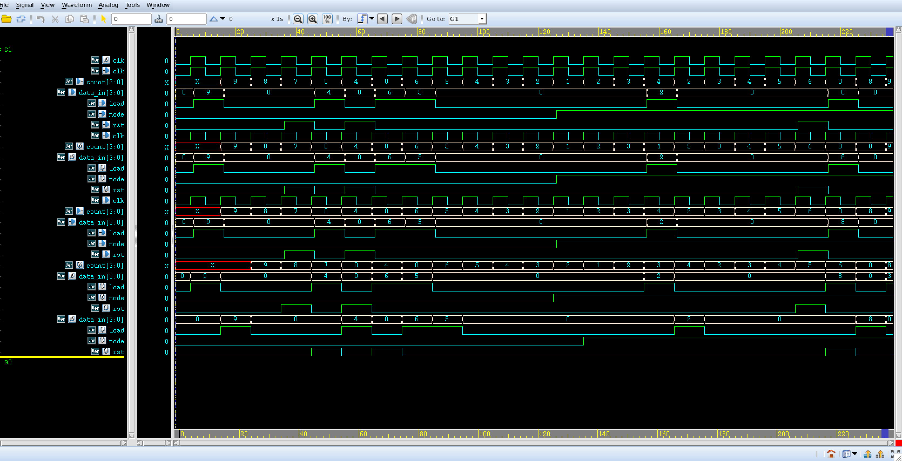
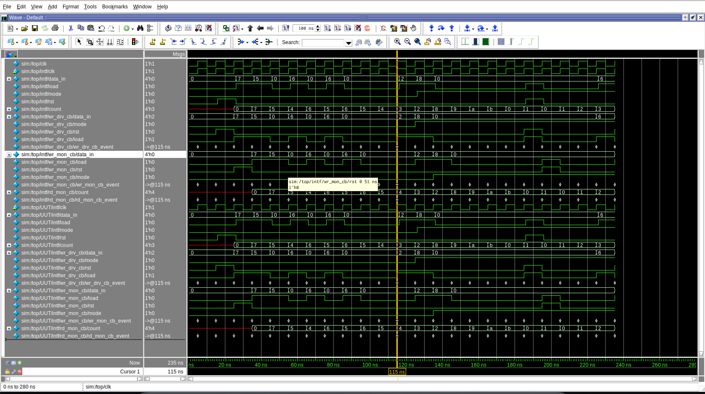

# Mod-12 Synchronous Up/Down Loadable Counter — SystemVerilog Verification

A layered, class-based SystemVerilog verification environment for a **4-bit Mod-12 Synchronous Up/Down Loadable Counter** (`mod12_counter`), supporting both **Synopsys VCS / Verdi** and **Mentor QuestaSim**.

---

## Repository Structure

```text
Mod_12_Counter/
├── rtl/
│   └── counter.sv                      # Mod-12 counter RTL (mod12_counter)
├── env_lib/
│   ├── interface.sv                    # mod_12_if with clocking blocks, modports & SVA
│   ├── trans.sv                        # mod12_trans transaction & constraints
│   ├── gen.sv                          # mod12_gen stimulus generator
│   ├── wr_drv.sv                       # write_drv pin-level driver
│   ├── wr_mon.sv                       # write_mon input monitor
│   ├── rd_mon.sv                       # read_mon output monitor
│   ├── rm.sv                           # ref_model golden reference model
│   └── sb.sv                           # sb scoreboard & mod12_cg covergroup
├── env/
│   └── env.sv                          # mod_env verification environment
├── test/
│   ├── package.sv                      # mod12_pkg (no_of_transactions = 24)
│   ├── test.sv                         # test class
│   └── top.sv                          # Top module, clock gen, DUT & FSDB dump
├── sim/
│   └── Makefile                        # VCS & QuestaSim build/run/coverage targets
├── Verification_Summary/
│   ├── result.md                       # Formatted VCS simulation log & summary
│   └── functional_coverage.md          # URG functional coverage report (100.00%)
├── Verification_Plan.md                # Full verification plan & feature matrix
├── Wave_VCS.png                        # VCS / Verdi waveform capture
├── Wave_Questa.png                     # QuestaSim waveform capture
├── .gitignore                          # Excludes simulator, coverage & OS artifacts
└── README.md                           # Project overview
```

---

## Design Under Test (DUT)

`mod12_counter` ([`rtl/counter.sv`](rtl/counter.sv)) is a synchronous counter triggered on `posedge clk` via [`mod_12_if`](env_lib/interface.sv):

| Signal | Width | Direction | Description |
| :--- | :---: | :---: | :--- |
| `clk` | 1-bit | Input | System clock (`10 ns` period in `test/top.sv`) |
| `rst` | 1-bit | Input | Synchronous active-high reset (`count <= 4'd0`) |
| `load` | 1-bit | Input | Synchronous active-high parallel load (`count <= data_in`) |
| `mode` | 1-bit | Input | Direction control (`1` = Up-count, `0` = Down-count) |
| `data_in` | 4-bit | Input | Parallel load value (`0`–`11`) |
| `count` | 4-bit | Output | Counter output (`0`–`11`) |

**Priority Order:** `rst` (highest) $\rightarrow$ `load` $\rightarrow$ `mode == 1` (up-count, wraps `11` $\rightarrow$ `0`) $\rightarrow$ `mode == 0` (down-count, wraps `0` $\rightarrow$ `11`).

---

## Verification Architecture

```text
+-------------+     gen2wr     +-------------+
|  mod12_gen  | -------------> |  write_drv  |
+-------------+                +-------------+
                                      | (wr_drv_cb)
                                      v
                               +-------------+
                               | mod12_counter| (DUT)
                               +-------------+
                                 ^         |
                   (wr_mon_cb)   |         | (rd_mon_cb)
                                 |         v
+-------------+    mon2rm      +-----------+     +----------+
|  write_mon  | -------------> | ref_model |     | read_mon |
+-------------+                +-----------+     +----------+
                                     |                 |
                               rm2sb |                 | mon2sb
                                     v                 v
                               +---------------------------+
                               |        sb (Scoreboard)    |
                               |  Checker + mod12_cg Cov   |
                               +---------------------------+
```

- **Constrained-Random Stimulus:** `mod12_trans` randomizes `rst`, `load`, `mode`, and `data_in` (`0..11`), sequencing 12 down-count transactions followed by 12 up-count transactions.
- **Self-Checking Scoreboard:** Compares DUT output (`read_mon`) against the golden `ref_model` (`===`) and samples `mod12_cg`.
- **SystemVerilog Assertions (SVA):** Embedded in `mod_12_if` ([`env_lib/interface.sv`](env_lib/interface.sv)) to verify synchronous reset priority, parallel load, up-count rollover (`11` $\rightarrow$ `0`), down-count underflow (`0` $\rightarrow$ `11`), step increment/decrement, and valid count bounds (`0`–`11`).
- **Functional Coverage (`mod12_cg`):** Tracks `RESET`, `MODE`, `LOAD`, `DATA_IN`, `COUNT`, illegal out-of-range bins (`[12:15]`), and `COUNT2` (`cross MODE, COUNT`).

---

## Verification Results

| Metric | Result |
| :--- | :---: |
| **Transactions Verified** | `24` |
| **Pass Count** | `24` |
| **Fail Count** | `0` |
| **Functional Coverage** | `100.00%` |
| **Illegal Bins Hit** | `0` |

### Detailed Documentation
- [Verification Plan](Verification_Plan.md)
- [Simulation Results & Log](Verification_Summary/result.md)
- [Functional Coverage Report](Verification_Summary/functional_coverage.md)

---

## Running Simulations

From the [`sim/`](sim/Makefile) directory:

### Synopsys VCS / Verdi
```bash
cd sim
make TC1_VCS        # Clean, compile, run +TEST1, and generate URG coverage report
make view_wave_VCS  # Open wave_file1.fsdb in Verdi
```

### Mentor QuestaSim
```bash
cd sim
make TC1_Questa        # Compile, run +TEST1, and generate vcover HTML report
make view_wave_Questa  # Open wave_file1.wlf in QuestaSim
```

---

## Waveform Captures

### Synopsys VCS / Verdi


*Figure 1: VCS / Verdi waveform (`0`–`235 ns`) showing initial parallel load (`9`), down-counting (`mode = 0`: `9` $\rightarrow$ `8` $\rightarrow$ `7` and `5` $\rightarrow$ `4` $\rightarrow$ `3` $\rightarrow$ `2` $\rightarrow$ `1`), synchronous reset recovery (`rst = 1` $\rightarrow$ `count = 0`), and up-counting (`mode = 1`: `1` $\rightarrow$ `2` $\rightarrow$ `3` $\rightarrow$ `4` and `2` $\rightarrow$ `3` $\rightarrow$ `4` $\rightarrow$ `5` $\rightarrow$ `6`) with interleaved parallel loads.*

### Mentor QuestaSim


*Figure 2: QuestaSim waveform (`0`–`235 ns`, cursor at `115 ns`) showing clocking-block stimulus (`wr_drv_cb`, `wr_mon_cb`, `rd_mon_cb`), down-counting (`mode = 0`), parallel loads (`7`, `5`, `6`, `2`, `8`, `6`), and up-counting (`mode = 1`) including the Mod-12 rollover from `4'hb` (`11`) to `4'h0` (`0`) around `175`–`185 ns`.*
