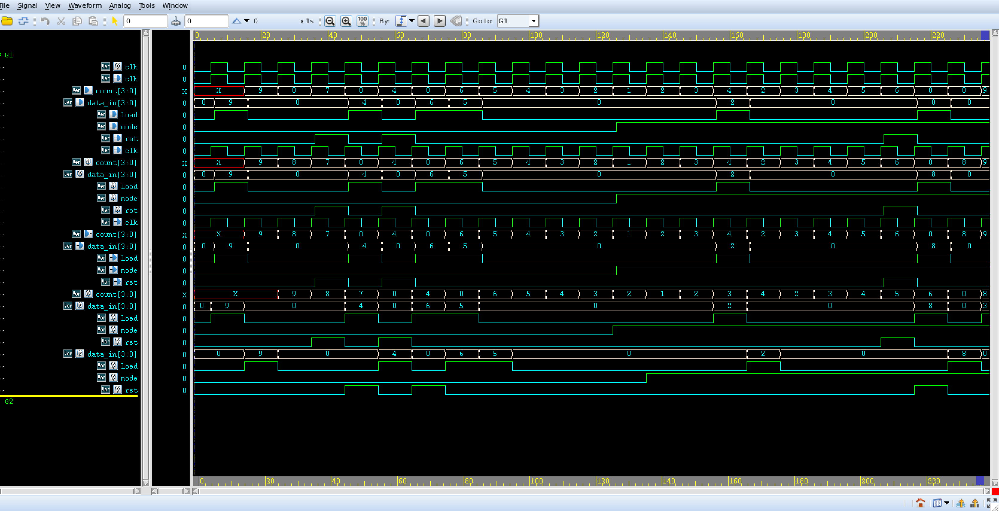
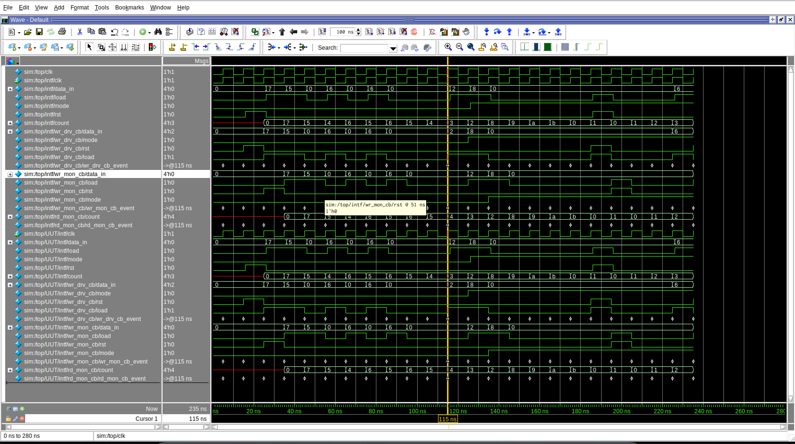

# Mod-12 Counter — Verification Results

## Run Summary

| Metric | Value |
| :--- | :--- |
| **Simulator** | Synopsys VCS `T-2022.06-SP1_Full64` |
| **Testcase** | `+TEST1` (`+ntb_random_seed=4137323363`) |
| **Total Data Verified** | `24` |
| **Pass Count** | `24` |
| **Fail Count** | `0` |
| **Functional Coverage** | `100.00%` |
| **Simulation End Time** | `235` (`../test/test.sv:32`) |
| **CPU Time** | `0.340 seconds` |

---

## Waveform Captures

### Synopsys VCS / Verdi (`Wave_VCS.png`)


### Mentor QuestaSim (`Wave_Questa.png`)


---

## Full Simulation Log

<details>
<summary>Click to expand full VCS simulation transcript (958 lines)</summary>

```text
Command: /simv -a vcs.log +fsdbfile+wave_file1.fsdb -cm_dir ./cov1 +ntb_random_seed=4137323363 +TEST1
Chronologic VCS simulator copyright 1991-2022
Contains Synopsys proprietary information.
Compiler version T-2022.06-SP1_Full64; Runtime version T-2022.06-SP1_Full64;  Nov 25 22:22 2026
========================================================
	DATA RANDOMISED
                   0	Transaction NO : 1
	RESET		= 0
	MODE		= 0
	LOAD		= 1
	Input Data		= 9
	Count		= x
========================================================
========================================================
	DATA RANDOMISED
                   0	Transaction NO : 2
	RESET		= 0
	MODE		= 0
	LOAD		= 0
	Input Data		= 0
	Count		= x
========================================================
========================================================
	DATA RANDOMISED
                   0	Transaction NO : 3
	RESET		= 0
	MODE		= 0
	LOAD		= 0
	Input Data		= 0
	Count		= x
========================================================
========================================================
	DATA RANDOMISED
                   0	Transaction NO : 4
	RESET		= 1
	MODE		= 0
	LOAD		= 0
	Input Data		= 0
	Count		= x
========================================================
========================================================
	DATA RANDOMISED
                   0	Transaction NO : 5
	RESET		= 0
	MODE		= 0
	LOAD		= 1
	Input Data		= 4
	Count		= x
========================================================
========================================================
	DATA RANDOMISED
                   0	Transaction NO : 6
	RESET		= 1
	MODE		= 0
	LOAD		= 0
	Input Data		= 0
	Count		= x
========================================================
========================================================
	DATA RANDOMISED
                   0	Transaction NO : 7
	RESET		= 0
	MODE		= 0
	LOAD		= 1
	Input Data		= 6
	Count		= x
========================================================
========================================================
	DATA RANDOMISED
                   0	Transaction NO : 8
	RESET		= 0
	MODE		= 0
	LOAD		= 1
	Input Data		= 5
	Count		= x
========================================================
========================================================
	DATA RANDOMISED
                   0	Transaction NO : 9
	RESET		= 0
	MODE		= 0
	LOAD		= 0
	Input Data		= 0
	Count		= x
========================================================
========================================================
	DATA RANDOMISED
                   0	Transaction NO : 10
	RESET		= 0
	MODE		= 0
	LOAD		= 0
	Input Data		= 0
	Count		= x
========================================================
========================================================
	DATA RANDOMISED
                   0	Transaction NO : 11
	RESET		= 0
	MODE		= 0
	LOAD		= 0
	Input Data		= 0
	Count		= x
========================================================
========================================================
	DATA RANDOMISED
                   0	Transaction NO : 12
	RESET		= 0
	MODE		= 0
	LOAD		= 0
	Input Data		= 0
	Count		= x
========================================================
========================================================
	DATA RANDOMISED
                   0	Transaction NO : 13
	RESET		= 0
	MODE		= 1
	LOAD		= 0
	Input Data		= 0
	Count		= x
========================================================
========================================================
	DATA RANDOMISED
                   0	Transaction NO : 14
	RESET		= 0
	MODE		= 1
	LOAD		= 0
	Input Data		= 0
	Count		= x
========================================================
========================================================
	DATA RANDOMISED
                   0	Transaction NO : 15
	RESET		= 0
	MODE		= 1
	LOAD		= 0
	Input Data		= 0
	Count		= x
========================================================
========================================================
	DATA RANDOMISED
                   0	Transaction NO : 16
	RESET		= 0
	MODE		= 1
	LOAD		= 1
	Input Data		= 2
	Count		= x
========================================================
========================================================
	DATA RANDOMISED
                   0	Transaction NO : 17
	RESET		= 0
	MODE		= 1
	LOAD		= 0
	Input Data		= 0
	Count		= x
========================================================
========================================================
	DATA RANDOMISED
                   0	Transaction NO : 18
	RESET		= 0
	MODE		= 1
	LOAD		= 0
	Input Data		= 0
	Count		= x
========================================================
========================================================
	DATA RANDOMISED
                   0	Transaction NO : 19
	RESET		= 0
	MODE		= 1
	LOAD		= 0
	Input Data		= 0
	Count		= x
========================================================
========================================================
	DATA RANDOMISED
                   0	Transaction NO : 20
	RESET		= 0
	MODE		= 1
	LOAD		= 0
	Input Data		= 0
	Count		= x
========================================================
========================================================
	DATA RANDOMISED
                   0	Transaction NO : 21
	RESET		= 1
	MODE		= 1
	LOAD		= 0
	Input Data		= 0
	Count		= x
========================================================
========================================================
	DATA RANDOMISED
                   0	Transaction NO : 22
	RESET		= 0
	MODE		= 1
	LOAD		= 1
	Input Data		= 8
	Count		= x
========================================================
========================================================
	DATA RANDOMISED
                   0	Transaction NO : 23
	RESET		= 0
	MODE		= 1
	LOAD		= 0
	Input Data		= 0
	Count		= x
========================================================
========================================================
	DATA RANDOMISED
                   0	Transaction NO : 24
	RESET		= 0
	MODE		= 1
	LOAD		= 1
	Input Data		= 3
	Count		= x
========================================================
*Verdi* Loading libsscore_vcs202206.so
FSDB Dumper for VCS, Release Verdi_T-2022.06-SP1, Linux x86_64/64bit, 08/28/2022
(C) 1996 - 2022 by Synopsys, Inc.
*Verdi* : Create FSDB file 'wave_file1.fsdb'
*Verdi* : Begin traversing the scope (top), layer (0).
*Verdi* : End of traversing.
========================================================
	DATA FROM WRITE MONITOR
                   5	Transaction NO : 0
	RESET		= 0
	MODE		= 0
	LOAD		= 0
	Input Data		= 0
	Count		= x
========================================================
========================================================
	DATA FROM DUT
                   5	Transaction NO : 0
	RESET		= 0
	MODE		= 0
	LOAD		= 0
	Input Data		= 0
	Count		= x
========================================================
========================================================
	DATA IN WRITE DRIVER
                   5	Transaction NO : 1
	RESET		= 0
	MODE		= 0
	LOAD		= 1
	Input Data		= 9
	Count		= x
========================================================
========================================================
[5] Count is Correct | Actual = x | Expected = x
========================================================
========================================================
	DATA FROM WRITE MONITOR
                  15	Transaction NO : 0
	RESET		= 0
	MODE		= 0
	LOAD		= 1
	Input Data		= 9
	Count		= x
========================================================
========================================================
	DATA FROM DUT
                  15	Transaction NO : 0
	RESET		= 0
	MODE		= 0
	LOAD		= 0
	Input Data		= 0
	Count		= x
========================================================
========================================================
	DATA IN WRITE DRIVER
                  15	Transaction NO : 2
	RESET		= 0
	MODE		= 0
	LOAD		= 0
	Input Data		= 0
	Count		= x
========================================================
========================================================
[15] Count is Correct | Actual = x | Expected = x
========================================================
========================================================
	DATA FROM WRITE MONITOR
                  25	Transaction NO : 0
	RESET		= 0
	MODE		= 0
	LOAD		= 0
	Input Data		= 0
	Count		= x
========================================================
========================================================
	DATA FROM DUT
                  25	Transaction NO : 0
	RESET		= 0
	MODE		= 0
	LOAD		= 0
	Input Data		= 0
	Count		= 9
========================================================
========================================================
	DATA IN WRITE DRIVER
                  25	Transaction NO : 3
	RESET		= 0
	MODE		= 0
	LOAD		= 0
	Input Data		= 0
	Count		= x
========================================================
========================================================
[25] Count is Correct | Actual = 9 | Expected = 9
========================================================
========================================================
	DATA FROM WRITE MONITOR
                  35	Transaction NO : 0
	RESET		= 0
	MODE		= 0
	LOAD		= 0
	Input Data		= 0
	Count		= x
========================================================
========================================================
	DATA FROM DUT
                  35	Transaction NO : 0
	RESET		= 0
	MODE		= 0
	LOAD		= 0
	Input Data		= 0
	Count		= 8
========================================================
========================================================
	DATA IN WRITE DRIVER
                  35	Transaction NO : 4
	RESET		= 1
	MODE		= 0
	LOAD		= 0
	Input Data		= 0
	Count		= x
========================================================
========================================================
[35] Count is Correct | Actual = 8 | Expected = 8
========================================================
========================================================
	DATA FROM WRITE MONITOR
                  45	Transaction NO : 0
	RESET		= 1
	MODE		= 0
	LOAD		= 0
	Input Data		= 0
	Count		= x
========================================================
========================================================
	DATA FROM DUT
                  45	Transaction NO : 0
	RESET		= 0
	MODE		= 0
	LOAD		= 0
	Input Data		= 0
	Count		= 7
========================================================
========================================================
	DATA IN WRITE DRIVER
                  45	Transaction NO : 5
	RESET		= 0
	MODE		= 0
	LOAD		= 1
	Input Data		= 4
	Count		= x
========================================================
========================================================
[45] Count is Correct | Actual = 7 | Expected = 7
========================================================
========================================================
	DATA FROM WRITE MONITOR
                  55	Transaction NO : 0
	RESET		= 0
	MODE		= 0
	LOAD		= 1
	Input Data		= 4
	Count		= x
========================================================
========================================================
	DATA FROM DUT
                  55	Transaction NO : 0
	RESET		= 0
	MODE		= 0
	LOAD		= 0
	Input Data		= 0
	Count		= 0
========================================================
========================================================
	DATA IN WRITE DRIVER
                  55	Transaction NO : 6
	RESET		= 1
	MODE		= 0
	LOAD		= 0
	Input Data		= 0
	Count		= x
========================================================
========================================================
[55] Count is Correct | Actual = 0 | Expected = 0
========================================================
========================================================
	DATA FROM WRITE MONITOR
                  65	Transaction NO : 0
	RESET		= 1
	MODE		= 0
	LOAD		= 0
	Input Data		= 0
	Count		= x
========================================================
========================================================
	DATA FROM DUT
                  65	Transaction NO : 0
	RESET		= 0
	MODE		= 0
	LOAD		= 0
	Input Data		= 0
	Count		= 4
========================================================
========================================================
	DATA IN WRITE DRIVER
                  65	Transaction NO : 7
	RESET		= 0
	MODE		= 0
	LOAD		= 1
	Input Data		= 6
	Count		= x
========================================================
========================================================
[65] Count is Correct | Actual = 4 | Expected = 4
========================================================
========================================================
	DATA FROM WRITE MONITOR
                  75	Transaction NO : 0
	RESET		= 0
	MODE		= 0
	LOAD		= 1
	Input Data		= 6
	Count		= x
========================================================
========================================================
	DATA FROM DUT
                  75	Transaction NO : 0
	RESET		= 0
	MODE		= 0
	LOAD		= 0
	Input Data		= 0
	Count		= 0
========================================================
========================================================
	DATA IN WRITE DRIVER
                  75	Transaction NO : 8
	RESET		= 0
	MODE		= 0
	LOAD		= 1
	Input Data		= 5
	Count		= x
========================================================
========================================================
[75] Count is Correct | Actual = 0 | Expected = 0
========================================================
========================================================
	DATA FROM WRITE MONITOR
                  85	Transaction NO : 0
	RESET		= 0
	MODE		= 0
	LOAD		= 1
	Input Data		= 5
	Count		= x
========================================================
========================================================
	DATA FROM DUT
                  85	Transaction NO : 0
	RESET		= 0
	MODE		= 0
	LOAD		= 0
	Input Data		= 0
	Count		= 6
========================================================
========================================================
	DATA IN WRITE DRIVER
                  85	Transaction NO : 9
	RESET		= 0
	MODE		= 0
	LOAD		= 0
	Input Data		= 0
	Count		= x
========================================================
========================================================
[85] Count is Correct | Actual = 6 | Expected = 6
========================================================
========================================================
	DATA FROM WRITE MONITOR
                  95	Transaction NO : 0
	RESET		= 0
	MODE		= 0
	LOAD		= 0
	Input Data		= 0
	Count		= x
========================================================
========================================================
	DATA FROM DUT
                  95	Transaction NO : 0
	RESET		= 0
	MODE		= 0
	LOAD		= 0
	Input Data		= 0
	Count		= 5
========================================================
========================================================
	DATA IN WRITE DRIVER
                  95	Transaction NO : 10
	RESET		= 0
	MODE		= 0
	LOAD		= 0
	Input Data		= 0
	Count		= x
========================================================
========================================================
[95] Count is Correct | Actual = 5 | Expected = 5
========================================================
========================================================
	DATA FROM WRITE MONITOR
                 105	Transaction NO : 0
	RESET		= 0
	MODE		= 0
	LOAD		= 0
	Input Data		= 0
	Count		= x
========================================================
========================================================
	DATA FROM DUT
                 105	Transaction NO : 0
	RESET		= 0
	MODE		= 0
	LOAD		= 0
	Input Data		= 0
	Count		= 4
========================================================
========================================================
	DATA IN WRITE DRIVER
                 105	Transaction NO : 11
	RESET		= 0
	MODE		= 0
	LOAD		= 0
	Input Data		= 0
	Count		= x
========================================================
========================================================
[105] Count is Correct | Actual = 4 | Expected = 4
========================================================
========================================================
	DATA FROM WRITE MONITOR
                 115	Transaction NO : 0
	RESET		= 0
	MODE		= 0
	LOAD		= 0
	Input Data		= 0
	Count		= x
========================================================
========================================================
	DATA FROM DUT
                 115	Transaction NO : 0
	RESET		= 0
	MODE		= 0
	LOAD		= 0
	Input Data		= 0
	Count		= 3
========================================================
========================================================
	DATA IN WRITE DRIVER
                 115	Transaction NO : 12
	RESET		= 0
	MODE		= 0
	LOAD		= 0
	Input Data		= 0
	Count		= x
========================================================
========================================================
[115] Count is Correct | Actual = 3 | Expected = 3
========================================================
========================================================
	DATA FROM WRITE MONITOR
                 125	Transaction NO : 0
	RESET		= 0
	MODE		= 0
	LOAD		= 0
	Input Data		= 0
	Count		= x
========================================================
========================================================
	DATA FROM DUT
                 125	Transaction NO : 0
	RESET		= 0
	MODE		= 0
	LOAD		= 0
	Input Data		= 0
	Count		= 2
========================================================
========================================================
	DATA IN WRITE DRIVER
                 125	Transaction NO : 13
	RESET		= 0
	MODE		= 1
	LOAD		= 0
	Input Data		= 0
	Count		= x
========================================================
========================================================
[125] Count is Correct | Actual = 2 | Expected = 2
========================================================
========================================================
	DATA FROM WRITE MONITOR
                 135	Transaction NO : 0
	RESET		= 0
	MODE		= 1
	LOAD		= 0
	Input Data		= 0
	Count		= x
========================================================
========================================================
	DATA FROM DUT
                 135	Transaction NO : 0
	RESET		= 0
	MODE		= 0
	LOAD		= 0
	Input Data		= 0
	Count		= 1
========================================================
========================================================
	DATA IN WRITE DRIVER
                 135	Transaction NO : 14
	RESET		= 0
	MODE		= 1
	LOAD		= 0
	Input Data		= 0
	Count		= x
========================================================
========================================================
[135] Count is Correct | Actual = 1 | Expected = 1
========================================================
========================================================
	DATA FROM WRITE MONITOR
                 145	Transaction NO : 0
	RESET		= 0
	MODE		= 1
	LOAD		= 0
	Input Data		= 0
	Count		= x
========================================================
========================================================
	DATA FROM DUT
                 145	Transaction NO : 0
	RESET		= 0
	MODE		= 0
	LOAD		= 0
	Input Data		= 0
	Count		= 2
========================================================
========================================================
	DATA IN WRITE DRIVER
                 145	Transaction NO : 15
	RESET		= 0
	MODE		= 1
	LOAD		= 0
	Input Data		= 0
	Count		= x
========================================================
========================================================
[145] Count is Correct | Actual = 2 | Expected = 2
========================================================
========================================================
	DATA FROM WRITE MONITOR
                 155	Transaction NO : 0
	RESET		= 0
	MODE		= 1
	LOAD		= 0
	Input Data		= 0
	Count		= x
========================================================
========================================================
	DATA FROM DUT
                 155	Transaction NO : 0
	RESET		= 0
	MODE		= 0
	LOAD		= 0
	Input Data		= 0
	Count		= 3
========================================================
========================================================
	DATA IN WRITE DRIVER
                 155	Transaction NO : 16
	RESET		= 0
	MODE		= 1
	LOAD		= 1
	Input Data		= 2
	Count		= x
========================================================
========================================================
[155] Count is Correct | Actual = 3 | Expected = 3
========================================================
========================================================
	DATA FROM WRITE MONITOR
                 165	Transaction NO : 0
	RESET		= 0
	MODE		= 1
	LOAD		= 1
	Input Data		= 2
	Count		= x
========================================================
========================================================
	DATA FROM DUT
                 165	Transaction NO : 0
	RESET		= 0
	MODE		= 0
	LOAD		= 0
	Input Data		= 0
	Count		= 4
========================================================
========================================================
	DATA IN WRITE DRIVER
                 165	Transaction NO : 17
	RESET		= 0
	MODE		= 1
	LOAD		= 0
	Input Data		= 0
	Count		= x
========================================================
========================================================
[165] Count is Correct | Actual = 4 | Expected = 4
========================================================
========================================================
	DATA FROM WRITE MONITOR
                 175	Transaction NO : 0
	RESET		= 0
	MODE		= 1
	LOAD		= 0
	Input Data		= 0
	Count		= x
========================================================
========================================================
	DATA FROM DUT
                 175	Transaction NO : 0
	RESET		= 0
	MODE		= 0
	LOAD		= 0
	Input Data		= 0
	Count		= 2
========================================================
========================================================
	DATA IN WRITE DRIVER
                 175	Transaction NO : 18
	RESET		= 0
	MODE		= 1
	LOAD		= 0
	Input Data		= 0
	Count		= x
========================================================
========================================================
[175] Count is Correct | Actual = 2 | Expected = 2
========================================================
========================================================
	DATA FROM WRITE MONITOR
                 185	Transaction NO : 0
	RESET		= 0
	MODE		= 1
	LOAD		= 0
	Input Data		= 0
	Count		= x
========================================================
========================================================
	DATA FROM DUT
                 185	Transaction NO : 0
	RESET		= 0
	MODE		= 0
	LOAD		= 0
	Input Data		= 0
	Count		= 3
========================================================
========================================================
	DATA IN WRITE DRIVER
                 185	Transaction NO : 19
	RESET		= 0
	MODE		= 1
	LOAD		= 0
	Input Data		= 0
	Count		= x
========================================================
========================================================
[185] Count is Correct | Actual = 3 | Expected = 3
========================================================
========================================================
	DATA FROM WRITE MONITOR
                 195	Transaction NO : 0
	RESET		= 0
	MODE		= 1
	LOAD		= 0
	Input Data		= 0
	Count		= x
========================================================
========================================================
	DATA FROM DUT
                 195	Transaction NO : 0
	RESET		= 0
	MODE		= 0
	LOAD		= 0
	Input Data		= 0
	Count		= 4
========================================================
========================================================
	DATA IN WRITE DRIVER
                 195	Transaction NO : 20
	RESET		= 0
	MODE		= 1
	LOAD		= 0
	Input Data		= 0
	Count		= x
========================================================
========================================================
[195] Count is Correct | Actual = 4 | Expected = 4
========================================================
========================================================
	DATA FROM WRITE MONITOR
                 205	Transaction NO : 0
	RESET		= 0
	MODE		= 1
	LOAD		= 0
	Input Data		= 0
	Count		= x
========================================================
========================================================
	DATA FROM DUT
                 205	Transaction NO : 0
	RESET		= 0
	MODE		= 0
	LOAD		= 0
	Input Data		= 0
	Count		= 5
========================================================
========================================================
	DATA IN WRITE DRIVER
                 205	Transaction NO : 21
	RESET		= 1
	MODE		= 1
	LOAD		= 0
	Input Data		= 0
	Count		= x
========================================================
========================================================
[205] Count is Correct | Actual = 5 | Expected = 5
========================================================
========================================================
	DATA FROM WRITE MONITOR
                 215	Transaction NO : 0
	RESET		= 1
	MODE		= 1
	LOAD		= 0
	Input Data		= 0
	Count		= x
========================================================
========================================================
	DATA FROM DUT
                 215	Transaction NO : 0
	RESET		= 0
	MODE		= 0
	LOAD		= 0
	Input Data		= 0
	Count		= 6
========================================================
========================================================
	DATA IN WRITE DRIVER
                 215	Transaction NO : 22
	RESET		= 0
	MODE		= 1
	LOAD		= 1
	Input Data		= 8
	Count		= x
========================================================
========================================================
[215] Count is Correct | Actual = 6 | Expected = 6
========================================================
========================================================
	DATA FROM WRITE MONITOR
                 225	Transaction NO : 0
	RESET		= 0
	MODE		= 1
	LOAD		= 1
	Input Data		= 8
	Count		= x
========================================================
========================================================
	DATA FROM DUT
                 225	Transaction NO : 0
	RESET		= 0
	MODE		= 0
	LOAD		= 0
	Input Data		= 0
	Count		= 0
========================================================
========================================================
	DATA IN WRITE DRIVER
                 225	Transaction NO : 23
	RESET		= 0
	MODE		= 1
	LOAD		= 0
	Input Data		= 0
	Count		= x
========================================================
========================================================
[225] Count is Correct | Actual = 0 | Expected = 0
========================================================
========================================================
	DATA FROM WRITE MONITOR
                 235	Transaction NO : 0
	RESET		= 0
	MODE		= 1
	LOAD		= 0
	Input Data		= 0
	Count		= x
========================================================
========================================================
	DATA FROM DUT
                 235	Transaction NO : 0
	RESET		= 0
	MODE		= 0
	LOAD		= 0
	Input Data		= 0
	Count		= 8
========================================================
========================================================
	DATA IN WRITE DRIVER
                 235	Transaction NO : 24
	RESET		= 0
	MODE		= 1
	LOAD		= 1
	Input Data		= 3
	Count		= x
========================================================
========================================================
[235] Count is Correct | Actual = 8 | Expected = 8
========================================================
------------------------------------------------------------
Total Data Verified = 24
PASS COUNT = 24
FAIL COUNT = 0
Functional Coverage = 100.00%
------------------------------------------------------------
$finish called from file "../test/test.sv", line 32.
$finish at simulation time                  235
           V C S   S i m u l a t i o n   R e p o r t 
Time: 235
CPU Time:      0.340 seconds;       Data structure size:   0.0Mb
Wed Nov 25 22:22:55 2026
```

</details>
